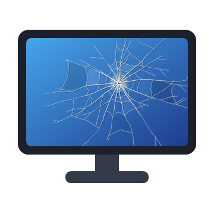
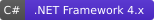
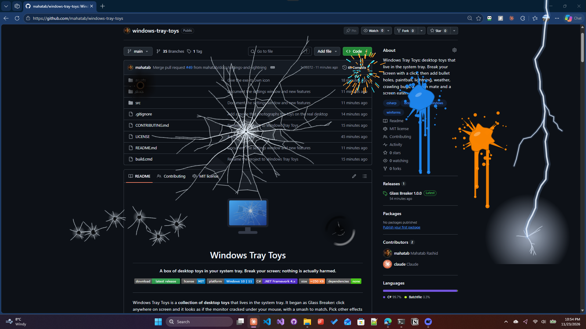
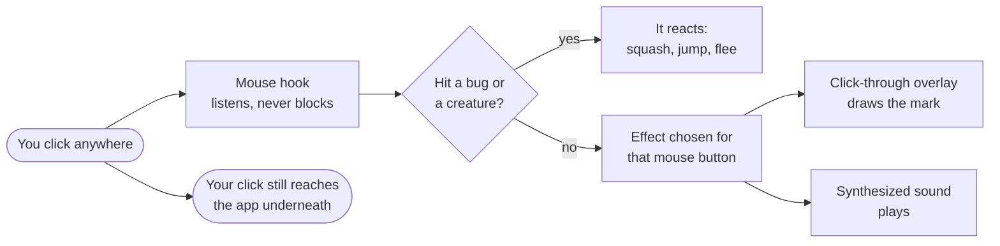
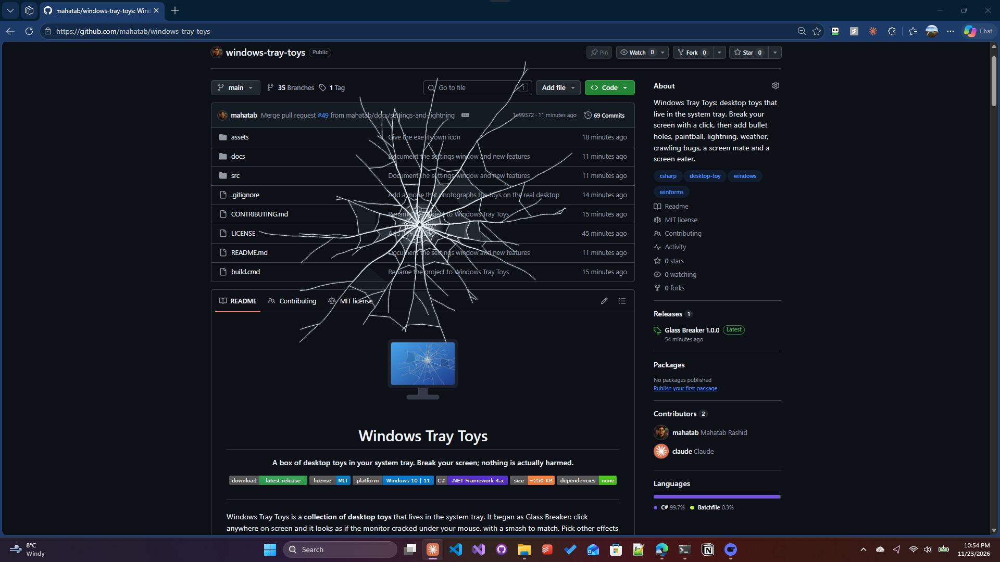
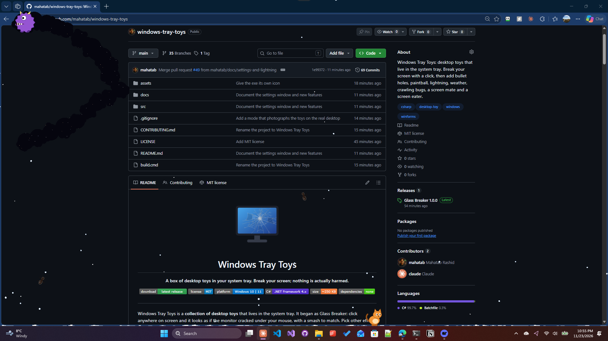
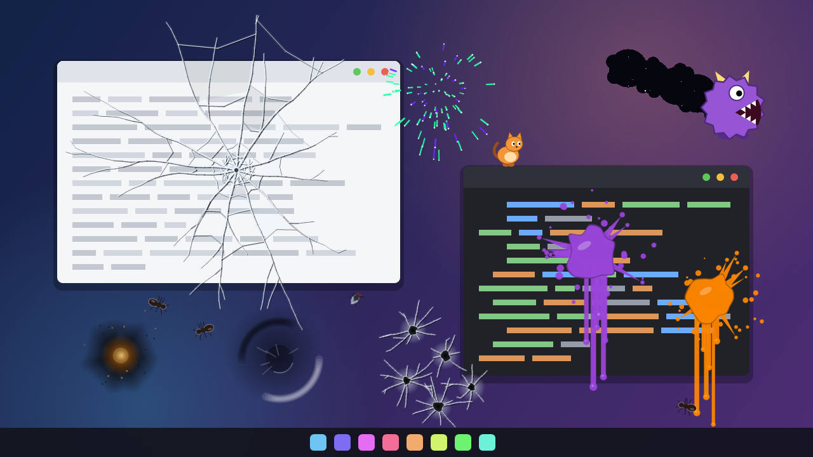
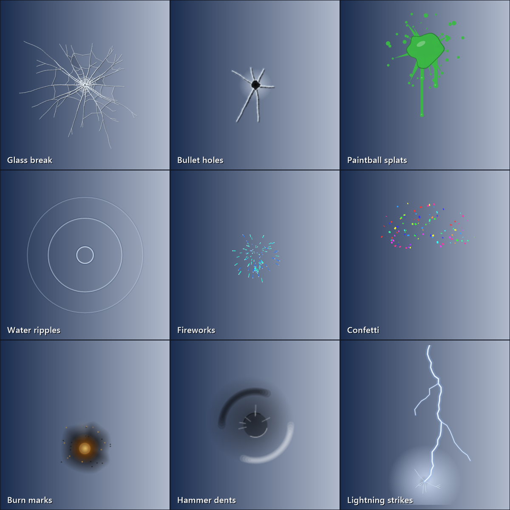
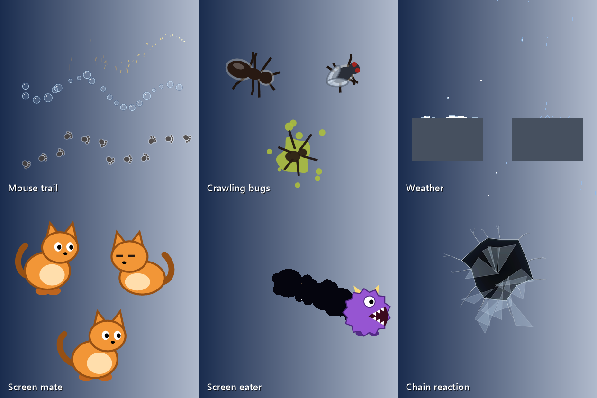
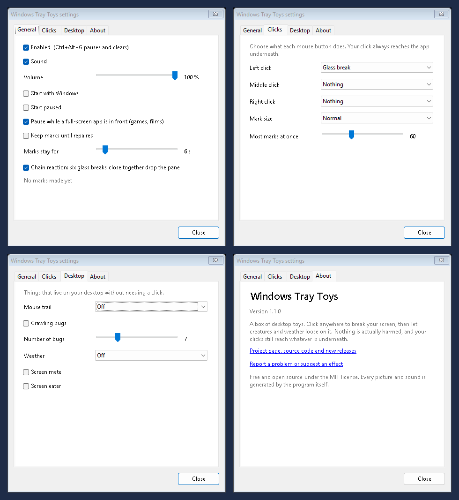

<p align="center">
  
</p>

<h1 align="center">Windows Tray Toys</h1>

<p align="center">
  <strong>A box of desktop toys in your system tray. Break your screen; nothing is actually harmed.</strong>
</p>

<p align="center">
  <a href="https://github.com/mahatab/windows-tray-toys/releases/latest"></a>
  <a href="LICENSE"></a>
  
  
  
  
</p>

---

Windows Tray Toys is a **collection of desktop toys** that lives in the system tray. It began as Glass Breaker: click anywhere on screen and it looks as if the monitor cracked under your mouse, with a smash to match. Pick other effects per mouse button, and switch on creatures and weather that share the desktop with you. Every overlay is **click-through**, so whatever you clicked still receives the click.

<p align="center">
  
</p>
<p align="center"><em>A real desktop after a few clicks — the browser underneath still works</em></p>

## Download

Get **`WindowsTrayToys.exe`** from the [latest release](https://github.com/mahatab/windows-tray-toys/releases/latest), then double-click it.

- **One file, about 250 KB** — no installer, nothing else to install on Windows 10 or 11
- **Code-signed and timestamped** — each release also lists its SHA-256 checksum
- **Easy to remove** — exit from the tray menu and delete the file

## How It Works



A low-level mouse hook hears every click but never intercepts it. Each click spawns a small, always-on-top, click-through window at that spot and draws a randomly generated mark into it, while a matching sound plays. Marks fade after a few seconds unless you ask to keep them. Creatures and weather run on their own overlays and get first refusal on each click.

## Features

### Click Effects
Pick a different effect for the **left**, **middle** and **right** mouse buttons.

- **Glass break** — spider-web cracks spread from the click and shards fly
- **Bullet holes** — a small puncture with short cracks; pepper the screen with them
- **Paintball splats** — a random colour, with drips that run down the screen
- **Water ripples** — rings spread out and fade, leaving no mark
- **Fireworks** — a burst of coloured sparks that droop and twinkle out
- **Confetti** — paper that flutters down
- **Burn marks** — a laser hit that glows, smokes and leaves a scorch
- **Hammer dents** — as if the screen were sheet metal
- **Lightning strikes** — a forked bolt from the top of the screen, with thunder
- **Random** — a different one every click

### Chain Reaction 
- Land **six glass breaks close together** and the whole pane gives way
- Big shards drop out of a jagged hole and fall down the screen, with a longer crash
- Can be turned off from the tray menu

### Mouse Trails
- **Sparks**, **bubbles** or **paw prints** follow the cursor
- Drawn in one small window that travels with the pointer, so it stays cheap

### Crawling Bugs
- **Ants and flies** wander the screen, each in its own tiny window
- **Click one to squash it** — the splat fades and a new bug walks in from the edge

### Weather
- **Snow** drifts down and **settles on the tops of your windows** and the taskbar
- Piles follow their window when it moves, and slowly melt
- **Rain** streaks past, splashes on window tops, and beads cling to the glass then run

### Screen Mate
- A small orange critter **walks along the taskbar** and **hops up onto windows**
- It sits down for naps, and drops to the floor if its window moves away
- **Click it** to make it jump

### Screen Eater
- A purple fuzzball wanders around **eating holes in your screen**
- Each bite reveals a starfield "behind" the desktop, and the eaten area keeps growing
- **Click it** and it bolts off-screen for a while; **Repair screen** gives everything back

### Settings Window
- **Double-click the tray icon** to open it; every change applies immediately
- **Start with Windows** — launches quietly at sign-in, with an option to **start paused**
- **Volume** and **how long marks stay** (1 to 60 seconds), or keep them until repaired
- **Mark size** (small to huge) and the **most marks on screen at once**
- **Number of bugs** in the swarm
- **Pauses for full-screen apps** — stays out of the way of games, films and presentations
- Keeps a running count of **how many marks you have made**

### Controls
- **Ctrl+Alt+G panic button** — clears the screen and pauses everything; press again to resume
- **Repair screen** — clear every mark at once
- Everything in the settings window is also a click away in the tray menu
- Choices are remembered between runs

### Small and Self-Contained
- **No assets** — every pattern is generated at random, so no two marks are alike
- **No audio files** — every sound is synthesized the first time the app runs
- **No runtime to install** — it uses the .NET Framework that ships with Windows
- **No network access** — nothing is downloaded or sent anywhere

## Screenshots

The first two pictures are straight off a real desktop, taken by `WindowsTrayToys.exe --screenshots`.

<p align="center">
  
</p>
<p align="center"><em>The original toy — one click, one broken screen</em></p>

<p align="center">
  
</p>
<p align="center"><em>The residents — snow settling on the taskbar, the screen eater's trail, and the screen mate</em></p>

<p align="center">
  
</p>
<p align="center"><em>A bit of everything at once, on an illustrated desktop</em></p>

<p align="center">
  
</p>
<p align="center"><em>The nine click effects — assign any of them to any mouse button</em></p>

<p align="center">
  
</p>
<p align="center"><em>Trails, bugs, weather, the screen mate, the screen eater, and the pane falling out</em></p>

<p align="center">
  
</p>
<p align="center"><em>The settings window — General, Clicks, Desktop and About</em></p>

## Tray Menu

| Item | What it does |
|------|--------------|
| **Settings...** | Open the settings window (also by double-clicking the icon) |
| **Enabled** | Pause or resume everything (also Ctrl+Alt+G) |
| **Left / Middle / Right click** | Choose the effect for each mouse button |
| **Mouse trail** | Off, Sparks, Bubbles or Footprints |
| **Crawling bugs** | Ants and flies on or off |
| **Weather** | Off, Snow or Rain |
| **Screen mate** | The critter on or off |
| **Screen eater** | The fuzzball on or off |
| **Sound** | All sounds on or off |
| **Keep marks until repaired** | Stop marks from fading |
| **Chain reaction** | Whether six glass breaks drop the pane |
| **Start with Windows** | Launch at sign-in |
| **Repair screen** | Clear every mark and give back anything eaten |
| **Exit** | Quit |

> Settings are stored in `%APPDATA%\WindowsTrayToys\settings.ini` and generated sounds in `%TEMP%\WindowsTrayToys`. Nothing else is written, apart from one registry entry if you tick **Start with Windows**.

## Quick Start

### Prerequisites

- **Windows** 10 or 11
- Nothing else &mdash; the C# compiler that builds it ships with Windows

### Run

```bat
git clone https://github.com/mahatab/windows-tray-toys.git
cd windows-tray-toys
build.cmd
WindowsTrayToys.exe
```

A tray icon appears. Click anywhere to break something; right-click the icon for options.

## Building

```bat
build.cmd
```

Produces `WindowsTrayToys.exe` next to the script. Exit any running copy first, because Windows locks the exe while it runs.

```bat
WindowsTrayToys.exe --selftest
WindowsTrayToys.exe --docs
WindowsTrayToys.exe --icon
WindowsTrayToys.exe --screenshots
```

| Mode | What it does |
|------|--------------|
| `--selftest` | Renders every effect and each settings tab to PNG without touching the screen, and checks that each sound opens |
| `--docs` | Regenerates the images in `docs/images` from the real drawing code |
| `--icon` | Regenerates `assets/app.ico`, the icon the build embeds in the exe |
| `--screenshots` | Stages three scenes on the real desktop and saves a picture of each to `screenshots/` |

## Architecture

```
build.cmd                 One-line build with the compiler that ships with Windows
└── src/
    ├── App.cs            Tray icon and menu, mouse hook, effect registry, settings, self-test
    ├── Native.cs         Win32 declarations
    ├── Layers.cs         LayerWin (per-pixel-alpha window), Decal (one mark), crack generator
    ├── Desktop.cs        List of visible windows, colour-keyed full-screen overlay
    ├── Sounds.cs         Synthesizes and plays every sound
    ├── Hotkey.cs         Ctrl+Alt+G
    ├── SettingsForm.cs   The settings window, and Start with Windows
    ├── AssemblyInfo.cs   Version information
    │
    ├── Glass.cs          Click effects: one Decal subclass each
    ├── Bullet.cs
    ├── Paintball.cs
    ├── Ripples.cs
    ├── Fireworks.cs      Fireworks and confetti
    ├── Burn.cs
    ├── Dent.cs
    ├── Lightning.cs
    ├── PaneFall.cs       The chain reaction
    │
    ├── Ambient.cs        IAmbient interface and registry for always-on features
    ├── Trail.cs
    ├── Bugs.cs
    ├── Weather.cs
    ├── Mate.cs
    ├── Eater.cs
    │
    └── DocImages.cs      Generates the README images and the icon; photographs the real desktop
```

### Tech Stack

| Layer | Technology |
|-------|-----------|
| Language | C# 5 (the compiler built into Windows) |
| Runtime | .NET Framework 4.x, preinstalled on Windows 10 and 11 |
| UI | Windows Forms tray icon and menu |
| Drawing | GDI+ |
| Marks and creatures | Layered windows with per-pixel alpha (`UpdateLayeredWindow`) |
| Weather and eaten screen | One colour-keyed full-screen window |
| Click detection | Low-level mouse hook (`WH_MOUSE_LL`), listen-only |
| Sound | Synthesized PCM written as WAV, played through MCI so sounds overlap |
| Signing | Azure Artifact Signing, timestamped |

## Documentation

Detailed docs live in the [`docs/`](docs/) directory:

- [Architecture](docs/ARCHITECTURE.md) — windows, the timer loop, how clicks are routed, sound synthesis
- [Adding Effects](docs/ADDING_EFFECTS.md) — step-by-step guide to add a click effect or an always-on feature

## Contributing

Contributions are welcome! See [CONTRIBUTING.md](CONTRIBUTING.md) for building, testing, code style, and PR guidelines.

## License

MIT &mdash; see [LICENSE](LICENSE) for details.
