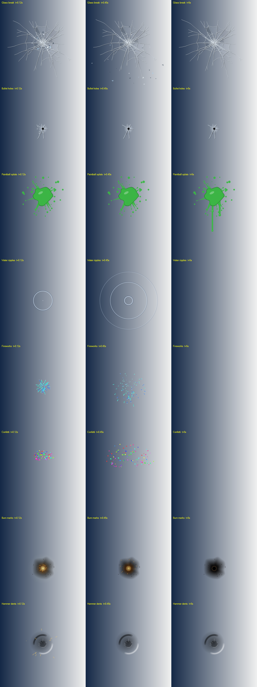
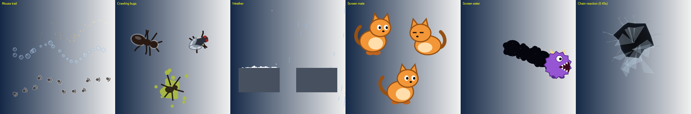

# Glass Breaker

A Windows desktop toy. It sits in the system tray, and clicking anywhere on screen leaves a
mark at that spot, with a matching sound. The default is a glass break that makes it look as
if the monitor cracked under the mouse.

Clicks are never blocked: everything is drawn on click-through overlays, so whatever you
clicked still receives the click.

## Download

Get `GlassBreaker.exe` from the [latest release](https://github.com/mahatab/glass-breaker/releases/latest).
It is one file of about 100 KB: no installer, and nothing else to install on Windows 10 or 11.
The exe is code-signed and timestamped, and each release lists its SHA-256 checksum.

## Use

Start `GlassBreaker.exe`, then click anywhere. A tray icon appears; right-click it for
everything else. To remove the toy, exit from the tray menu and delete the file. Settings are
kept in `%APPDATA%\GlassBreaker`, and generated sounds in `%TEMP%\GlassBreaker`.

### Click effects

Pick one for each mouse button under **Left click**, **Middle click** and **Right click**:

| Effect | What it does |
|---|---|
| Glass break | Spider-web cracks and flying shards |
| Bullet holes | A small puncture with short cracks |
| Paintball splats | A coloured splat whose drips run down the screen |
| Water ripples | Rings spreading from the click |
| Fireworks | A burst of coloured sparks |
| Confetti | Paper that flutters down |
| Burn marks | A laser hit that glows, smokes and leaves a scorch |
| Hammer dents | A dent, as if the screen were sheet metal |
| Random | A different one each click |

**Chain reaction:** six glass breaks close together and the whole pane falls out.

Each row below is one effect, shown 0.12 s, 0.45 s and 5 s after the click:

### Always-on features

| Feature | What it does |
|---|---|
| Mouse trail | Sparks, bubbles or paw prints follow the cursor |
| Crawling bugs | Ants and flies wander the screen; click one to squash it |
| Weather | Snow that settles on window tops and the taskbar, or rain |
| Screen mate | A critter that walks the taskbar, hops onto windows and naps; click it to make it jump |
| Screen eater | A fuzzball that eats holes in the screen until you repair it; click it to chase it off |

### Controls

- **Enabled**, or double-click the tray icon: pause and resume.
- **Ctrl+Alt+G**: panic button. Clears the screen and pauses; press again to resume.
- **Repair screen**: clear every mark and give back anything eaten.
- **Keep marks until repaired**: marks normally fade after about six seconds.
- **Sound**, **Start with Windows**.

Choices are saved in `%APPDATA%\GlassBreaker\settings.ini`.

## Build from source

Run `build.cmd`. It uses the C# compiler that ships with Windows (.NET Framework 4.x), so no
SDK is needed. The result is a single `GlassBreaker.exe` next to the script. Exit any running
copy first, because Windows locks the exe while it runs.

## How it works

- A low-level mouse hook listens for clicks without intercepting them.
- Each mark is its own small, topmost, click-through layered window with per-pixel alpha
  (`src/Layers.cs`); each effect is one class that draws into it.
- Full-screen features (weather, the eaten screen) use one colour-keyed overlay instead, which
  is much cheaper at that size (`src/Desktop.cs`).
- Every pattern is generated randomly and every sound is synthesized at first run
  (`src/Sounds.cs`), so there are no image or audio assets.
- `GlassBreaker.exe --selftest` renders every effect to PNG contact sheets without touching
  the screen and checks that each sound opens.

Adding a click effect means writing one `Decal` subclass and one line in `Effects` (`src/App.cs`).
Adding an always-on feature means one `IAmbient` class and one line in `Ambients` (`src/Ambient.cs`).
