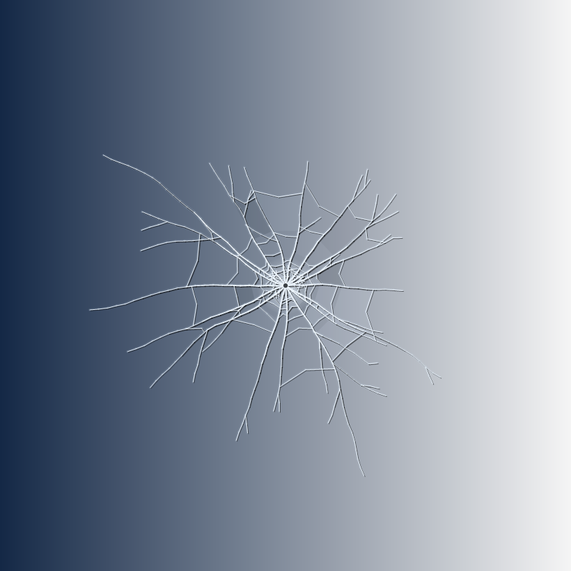

# Glass Breaker

A Windows desktop toy. It sits in the system tray, and every left click anywhere on screen
"cracks the monitor" at that spot with an animated glass break and a smash sound.

Clicks are never blocked: the crack is drawn on a click-through overlay, so whatever you
clicked still receives the click.

## Build

Run `build.cmd`. It uses the C# compiler that ships with Windows (.NET Framework 4.x), so no
SDK is needed. The result is a single `GlassBreaker.exe` with no dependencies.

## Use

Start `GlassBreaker.exe`, then click anywhere. Right-click the tray icon to:

- turn breaking on or off (double-clicking the icon does the same)
- turn the sound on or off
- keep cracks until cleared, instead of fading after about 6 seconds
- repair the screen (clear all cracks)
- exit

## How it works

- A low-level mouse hook listens for left clicks without intercepting them.
- Each crack is its own small, topmost, click-through layered window with per-pixel alpha.
- The crack pattern (radial cracks, branches, spider-web rings, shards) is generated randomly per click.
- The smash sounds are synthesized at startup (thump, noise burst, ringing tinkles) and written
  to `%TEMP%\GlassBreaker`.
