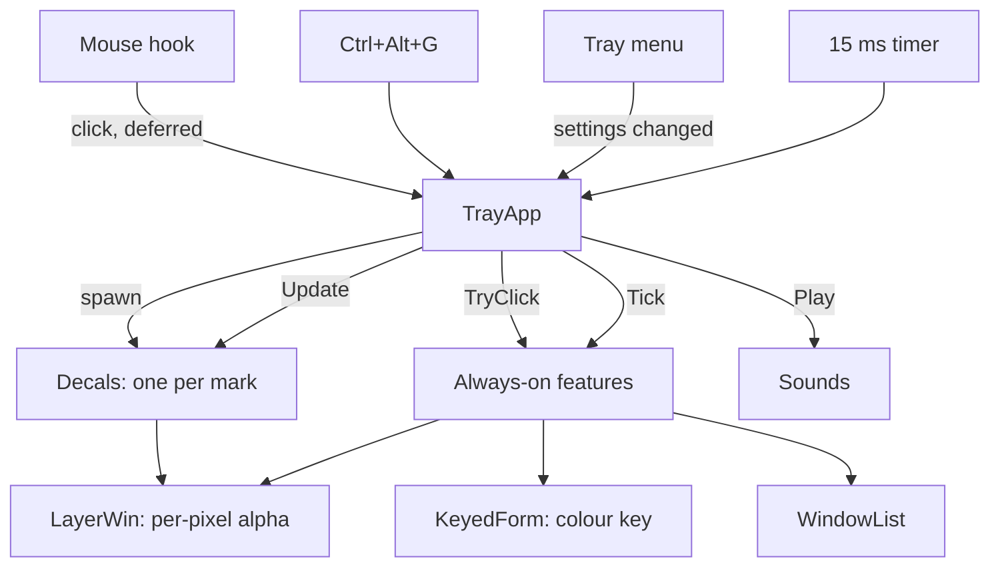

# Architecture

Windows Tray Toys is one small Windows Forms process with no main window. It owns a tray icon, a
mouse hook, a timer, and a changing set of overlay windows. Everything runs on the UI thread.

## The pieces

| Piece | File | Job |
|-------|------|-----|
| `TrayApp` | `App.cs` | Owns everything; builds the menu; routes clicks; runs the timer |
| `Effects` / `EffectDef` | `App.cs` | Registry of click effects |
| `Ambients` / `AmbientDef` | `Ambient.cs` | Registry of always-on features |
| `Settings` | `App.cs` | `key=value` file in `%APPDATA%\WindowsTrayToys` |
| `LayerWin` | `Layers.cs` | A small click-through window with per-pixel alpha |
| `Decal` | `Layers.cs` | One mark: animates, holds, fades |
| `KeyedForm` | `Desktop.cs` | A full-screen click-through window with one transparent colour |
| `WindowList` | `Desktop.cs` | Visible top-level windows in front-to-back order |
| `Sounds` | `Sounds.cs` | Synthesizes and plays sounds |

## Two kinds of overlay

**Per-pixel alpha (`LayerWin`).** Used for marks and creatures. Each is a `WS_EX_LAYERED`
window updated with `UpdateLayeredWindow` from a 32-bit bitmap, so it has soft edges and real
transparency. The cost is proportional to the window's area, which is why each mark gets its
own small window rather than sharing one screen-sized surface.

**Colour key (`KeyedForm`).** Used for weather and the eaten screen, which really are
screen-sized. One colour (magenta) is fully transparent and everything else is opaque. Normal
double-buffered painting applies, and only changed regions need repainting. The trade-off is
hard edges: anything drawn here must skip anti-aliasing, or it would blend with the key colour
and leave a fringe.

Every overlay has `WS_EX_TRANSPARENT`, `WS_EX_NOACTIVATE`, `WS_EX_TOOLWINDOW` and
`WS_EX_TOPMOST`: clicks pass through, focus never moves, and nothing appears in the taskbar or
Alt+Tab.

## The life of a click

1. The `WH_MOUSE_LL` hook sees a button-down. It notes the position and button, queues the real
   work with `BeginInvoke`, and immediately calls `CallNextHookEx`. The hook never swallows
   or delays a click.
2. `OnClick` offers the click to each running always-on feature (`TryClick`). A squashed bug or
   a poked creature claims it, and no effect is spawned.
3. Otherwise the effect assigned to that button is looked up in `Effects`, its sound plays, and
   its `Decal` is created at the click position.
4. For glass breaks, `ChainReaction` counts nearby glass decals; at six it replaces them with
   one `PaneFallDecal`.

Clicks are ignored while the tray menu is open, and while the toy is paused.

## The life of a decal

A `Decal` has two layers and three phases.

| Phase | What happens |
|-------|--------------|
| Animate (`t < AnimTime`) | Every tick: draw the still layer, then the overlay layer, push to the window |
| Hold | The still layer is rendered once, cached, and left alone |
| Fade | The cached bitmap is pushed with falling opacity, then the window is destroyed |

- `RenderStill(g, t)` draws what lasts: the cracks, the scorch, the paint. Until `StillAt` it is
  called each frame so it can grow in; after that it is rendered once and cached.
- `RenderOverlay(g, t, dt)` draws what moves: shards, sparks, smoke. It stops at `AnimTime`.
- Effects with nothing lasting (ripples, fireworks, confetti) set `HasStill = false` and simply
  end when the animation does.

`Simulate(t)` steps the same code without a window, which is what the self-test and the
documentation images use.

## The timer

One 15 ms Windows Forms timer drives everything: it updates every decal and ticks every running
always-on feature. It stops itself when there is nothing to animate, so an idle Windows Tray Toys
does no work at all. Weather halves its own rate to about 30 fps.

## Knowing about other windows

`WindowList` enumerates visible top-level windows twice a second, skipping minimized, cloaked
and tool windows, the desktop itself, and Windows Tray Toys's own overlays. It adds a pseudo-window
for the taskbar, called the floor. `TopVisibleAt` asks Windows what is really showing at a point
on a window's top edge, so snow does not settle on, and the screen mate does not stand on, an
edge that another window covers. Because every overlay is click-through, those hit tests see
straight through Windows Tray Toys's own windows.

## Sound

There are no audio files. On first run `Sounds` synthesizes a few variations of each named sound
as 16-bit mono PCM and writes them to `%TEMP%\WindowsTrayToys`:

| Sound | Recipe |
|-------|--------|
| `smash`, `crash` | Low thump + high-passed noise burst + dozens of decaying sine "tinkles" |
| `gunshot` | Noise through a closing low-pass + a falling low sine |
| `splat`, `squish` | Low-passed noise + downward chirps |
| `plip` | Two short upward sine chirps |
| `pop` | Thump + burst, then sparse crackle clicks |
| `sizzle` | A falling zap + high-passed noise with random flutter |
| `clang` | Six inharmonic sine partials with different decay rates |
| `crunch` | Three to five short band-limited noise bursts |

Each file is opened as its own MCI device, so several sounds can overlap. A variation is never
played twice in a row, which keeps the one still ringing from being cut off.

## Display scaling

The process declares itself per-monitor DPI aware before creating any window. Mouse hook
coordinates, window positions and bitmaps are then all in physical pixels, so marks land exactly
under the cursor. Sizes are multiplied by a scale factor taken from the primary display.
